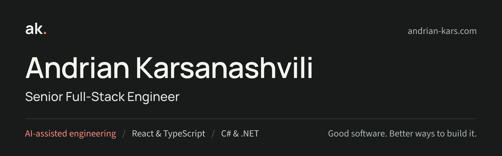

**[Portfolio](https://andrian-kars.com)** ([Español](https://andrian-kars.com/es)) · **[CV (PDF)](https://andrian-kars.com/andrian-kars-cv.pdf)** ([ES](https://andrian-kars.com/andrian-kars-cv-es.pdf)) · **[LinkedIn](https://www.linkedin.com/in/andrian-kars/)** · **[Email](mailto:andrian.karsanashvili@gmail.com)**

Hi, I'm Andrian 👋 A senior full-stack engineer in Galicia, Spain, with 7+ years across enterprise insurance software and client applications, including continuous work at EPAM for Vertafore since 2021. I build React/TypeScript interfaces and C#/ASP.NET Core services, and set up AI-agent workflows that help teams analyse, build, test and review, with people making the final call.

Open to roles in Spain and across Europe.

### What I do

- **AI-assisted engineering:** GitHub Copilot custom agents, reusable prompts and repository instructions that carry work from legacy analysis to review, with explicit handoffs, build and test checks, and human review gates. On Sagitta, this cut typical page delivery, including testing and review, from about a month to between a few days and three weeks.
- **Full-stack delivery:** legacy workflows modernized into React and TypeScript, backed by C#/ASP.NET Core APIs, permissions and data fixes.
- **Performance & architecture:** faster builds, fewer renders, shared component libraries and roadmaps teams can act on.
- **Team & delivery:** mentoring engineers from junior to senior, and automating the busywork around delivery.

### Selected impact

| 18&nbsp;→&nbsp;6 | 200%+ | ~40s&nbsp;→&nbsp;15–&#8288;18s | 9&nbsp;→&nbsp;1 |
| :-- | :-- | :-- | :-- |
| months to deliver (est.) | faster CI/CD pipeline | Webpack build time | redundant UI renders |

### Stack

| Area | Tools |
| :-- | :-- |
| **AI-assisted** |     |
| **Front end** |          |
| **Back end** |        |
| **Quality & delivery** |         |

### On GitHub

Most of my work lives in private enterprise repositories. Public projects:

- **[personal](https://github.com/andrian-kars/personal)**: the source of [andrian-kars.com](https://andrian-kars.com), in English and Spanish. Next.js 16, React 19 and strict TypeScript, checked with Playwright and axe accessibility tests on every push. It also serves Sharkies at [/sharkies](https://andrian-kars.com/sharkies) and Solidaro at [/solidaro](https://andrian-kars.com/solidaro).
- **[antelu](https://github.com/andrian-kars/antelu)**: [antelu.es](https://antelu.es), a multilingual catalogue for a children's ride-on vehicle rental in Galicia. Vehicles and photos are edited in the browser with Sveltia CMS, saved as commits. Next.js, TypeScript and Tailwind.
- **[sharkies](https://github.com/andrian-kars/sharkies)** ([live](https://andrian-kars.com/sharkies)): a film browser for shark, megalodon and giant-monster movies with live search across movies and series, in English and Ukrainian. React, TypeScript and the TMDB API, with Playwright and axe tests in Chromium, WebKit and on mobile.
- **[solidaro](https://github.com/andrian-kars/solidaro)** ([live](https://andrian-kars.com/solidaro)): the website of Solidaro, my small web development studio, in English, Ukrainian, German and Japanese. A static Next.js export on GitHub Pages, with Playwright and axe tests on every push.
